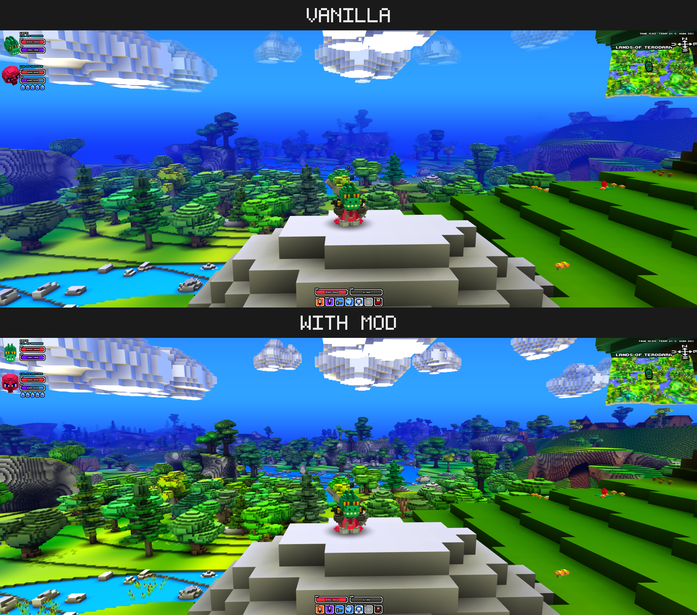

# Cube World Render Distance Mod

The render distance in Cube World is quite limited, and there is a technical
reason for it. Cube World is 32-bit, which limits the amount of memory it can
address, and render distance needs memory to load the world.

The vanilla `Cube.exe` can allocate only up to 2 GB of memory. This is already a
tight budget, so this mod can only add 15% more render distance without risking
a crash.

This is where LAA-patching comes into play. With *large-address aware*, 32-bit
executables can use up to 4 GB of memory instead. Cube World does not set this
LAA flag, but it seems to be able to handle such addresses without any issues.
See [Patching](#patching) on how to patch your `Cube.exe`. With this patch, the
mod can add up to 100% more render distance.

The render distance controls in the options still work as usual, but the mod
rescales them. On startup, the mod checks if `Cube.exe` was LAA-patched and
picks its upper limit accordingly: without the patch, 100% in the options
corresponds to about 115% of the vanilla render distance, and with the patch,
to about 200%.

*The same view in vanilla and with the mod on an LAA-patched `Cube.exe`.
Everything that fades into the blue fog in vanilla stays visible: the mountains on
the left, the village on the right, and even the reeds by the river.*

> **Warning**  
> This mod tries to use as much memory as possible for more render distance
> while still maintaining enough headroom for other things. Despite testing and
> safety margins, running out of memory is still possible, which can cause
> severe stuttering and eventually crash the game. Reducing the render distance
> in the options will likely help.

This mod is for the **alpha** build of Cube World.

## Patching

Patching is entirely optional, but it greatly increases the effect of the higher
render distance.

* download the `laa.ps1` and `patch.bat` files from the releases
* put `Cube.exe` and both files into the same directory
* run the `patch.bat` by double-clicking
  * a terminal window opens and should tell you `LAA flag set` when successful
* close the terminal window by pressing any key
* copy the `Cube.exe` back to your game directory if necessary

Your `Cube.exe` is now patched, and your original file was copied to
`Cube.exe.bak`. `laa.ps1` and `patch.bat` are not needed anymore and can be
deleted.

## Installation

* requires [coremaze Cube-World-Mod-Launcher](https://github.com/coremaze/Cube-World-Mod-Launcher/releases/tag/v1.5)
* unpack Mod Launcher in the game directory
* put `RenderDistanceMod.dll` into `Mods`
* start the game via `CubeModLauncher.exe`

## Compilation

Requires a compiler that targets 32-bit Windows. Run `make` in this directory
and specify the compiler as `CXX` variable if necessary (e.g.
`make CXX=i686-w64-mingw32-g++`).
